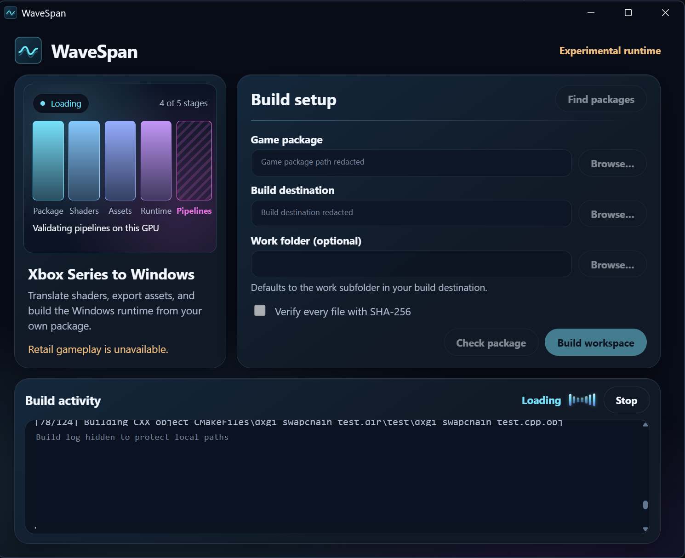

<h1 align="center"><br>WaveSpan</h1>

<p align="center"><strong>Experimental Xbox Series runtime and shader translation toolkit</strong></p>

<p align="center">
  <a href="#tested-games">Tested games</a> &middot;
  <a href="#how-to-build">Build guide</a> &middot;
  <a href="docs/README.md">Documentation</a> &middot;
  <a href="#want-to-help">Contribute</a> &middot;
  <a href="SECURITY.md">Security</a> &middot;
  <a href="docs/i18n/README.md">Other languages</a>
</p>

WaveSpan works with the supported Xbox Series package, version 1.0.2.1. It loads x86-64 code through a Windows
runtime, translates precompiled RDNA2 shaders to Vulkan SPIR-V, and exports assets from your own copy.
The build runs on your PC.

> [!IMPORTANT]
> **WaveSpan is in development. The retail game does not boot, and there is no playable build.**
> The repository contains source code and format notes. You supply your own package with its files already
> readable on disk. WaveSpan reads files as supplied and includes no decryption tools or keys. Keep game files,
> generated shaders, extracted assets, and saves on your PC.



## Tested games

### GTA VI · Xbox Series 1.0.2.1

| Function | Progress |
| --- | --- |
| Package validation | Supported. Checks file names and sizes, with optional SHA-256 verification. [Manifest](game/xbox-1.0.2.1.json) |
| Asset export | Working for models, textures, and audio. Some model layouts and BCPack textures have limited coverage. [Asset documentation](docs/README.md#archives-and-assets) |
| Shader translation | All **26,503 primary shaders** translated and passed `spirv-val` in a recorded run. Some cross-half wave64 operations remain approximate on 32-wide GPUs. [Shader validation](docs/shader_validation.md#why-spirv-val-is-not-enough) |
| Windows loader and platform | Stand-in tests cover startup, TLS, file I/O, threads, and shim imports. GDK coverage is partial. [Runtime tests](docs/testing.md) |
| Xbox D3D12 to Vulkan | Synthetic GPU tests render frames. Retail pipeline and presentation coverage is still in progress. [Graphics roadmap](docs/d3d12_vulkan.md) |
| Retail boot and gameplay | Retail startup reached D3D12 descriptor-heap initialization. The host-backed heap fix passed a synthetic GPU test on an RTX 5070 Laptop GPU. A retail run with that fix and the first rendered frame remain unverified. |

## How to build

### Quick start on Windows

1. Install the prerequisites below.
2. Open your WaveSpan checkout and initialize its submodule.

   ```powershell
   git submodule update --init --recursive
   ```

3. Double-click `Build.bat` to open WaveSpan. It opens the Windows EXE when built and uses the Python launcher otherwise.
4. Select the folder containing `MicrosoftGame.Config` and the readable `.rpf` archives. Choose **Check package**
   to validate it or **Build workspace** to start the build. Watch progress in **Build activity**.

WaveSpan searches common folders for your package and puts new builds in `Documents\WaveSpan` by default.
It reuses completed stages on subsequent runs. To resume a build in another folder, choose that folder or pass `--out`.
Choose a separate work folder if another drive has more free space. On Windows, the launcher caps the build worker and its child processes at 80% total CPU, keeps the system awake during the build, and lets the worker run to completion.

### Prerequisites

- **Your own copy** of the Xbox Series package, version 1.0.2.1.
- **Windows 10/11 x64**, with about **350 GB** free for work files. They can go on another drive with `--work`.
- Git for Windows is required to initialize the archive-reader submodule.
- [Python 3.12+](https://www.python.org/downloads/) (tick "Add python.exe to PATH").
- **Asset export:** .NET SDK 8 or newer on PATH to build the .NET 8 archive tool, plus the .NET 8 runtime to run it. The .NET 8 SDK includes that runtime. [Download .NET 8](https://dotnet.microsoft.com/download/dotnet/8.0).
- **Windows launcher:** use the .NET 10 SDK to publish it. Running the published EXE requires the x64 .NET 10 Desktop Runtime and WebView2. [Download .NET 10](https://dotnet.microsoft.com/download/dotnet/10.0) · [Download WebView2](https://developer.microsoft.com/microsoft-edge/webview2/).
- [Vulkan SDK](https://vulkan.lunarg.com/), for `spirv-as` / `spirv-val`.
- [LLVM 21+](https://github.com/llvm/llvm-project/releases) with the **AMDGPU target** for `llvm-mc`. The official
  Windows build has no AMDGPU target. On Windows, `scripts\build_llvm_mc.ps1` builds a native `llvm-mc.exe` with it
  (no WSL; needs git and the Visual Studio C++ tools below) and sets `LLVM_MC`. Or install `llvm-21` in WSL and set
  `LLVM_MC` to the whole command, `LLVM_MC="wsl -d Ubuntu -e /usr/lib/llvm-21/bin/llvm-mc"` (see
  [docs/design.md](docs/design.md#disassembling-shaders)). On Linux, `llvm-mc` on PATH is enough.
- Visual Studio 2022 with **Desktop development with C++** and the **Windows SDK 10.0.26100 or newer**, for the
  runtime stage (the runtime uses version 1.2 root signatures, which older SDKs don't declare).
- [ffmpeg](https://ffmpeg.org/download.html) on PATH (optional: decodes the XMA2 streams, and required for `--wav`).

### Build the optional Windows launcher EXE

From the repository root, use the .NET 10 SDK:

```powershell
dotnet publish tools/WaveSpanLauncher/WaveSpanLauncher.csproj -c Release -r win-x64 --self-contained false
```

Open `WaveSpanLauncher.exe` in `tools/WaveSpanLauncher/bin/Release/net10.0-windows/win-x64/publish/` directly,
or double-click `Build.bat`. Direct launch needs the adjacent `wwwroot` directory, the WaveSpan checkout,
Python 3.12+, the .NET 10 Desktop Runtime, and the Microsoft Edge WebView2 Runtime. The EXE calls the same
`make_game.py` builder. WebView2 saves its profile under `%LOCALAPPDATA%\WaveSpan\WebView2`.

### Build from a terminal

```powershell
python -I make_game.py --launcher                      # open the desktop launcher
python -I make_game.py --find                          # list the copies found on this PC
python -I make_game.py --pick                          # choose the game folder in a folder dialog
python -I make_game.py --check                         # check your copy, build nothing
python -I make_game.py --check --full-check            # also compare SHA-256 of every file (slow)
python -I make_game.py --game "D:\path\to\your\package" --out "D:\Games\WaveSpan" --work "E:\wavespan-work"
python -I make_game.py --stages shaders,assets         # only some stages
python -I make_game.py --game "D:\path\to\your\package" --wav   # also decode Opus to PCM WAV (large)
python -I make_game.py --wave64-emulate off            # auto (default), on or off; see below
```

`--wave64-emulate` decides whether wave64 compute and mesh shaders are translated to be exact on any subgroup size
(see "Wave64 emulation" in [docs/design.md](docs/design.md)). NVIDIA and Intel GPUs have 32-wide subgroups and need
it. The default, `auto`, asks `vulkaninfo` (part of the Vulkan SDK) and turns it on unless every GPU reports 64-wide
subgroups, or when it can't tell; it also turns it on when the GPU the runtime would use can't be made to run
compute and mesh shaders 64-wide. One exception keeps it off: when the runtime's GPU is an RDNA2 card or iGPU
(RX 6000, Ryzen 6000/7000/9000 graphics) on AMD's Windows driver and runs wave64 natively, because that driver's
shader compiler crashes on emulated LDS code (#857); an Intel iGPU next to an RX 6000 card would otherwise turn it on.
The mode is saved next to the translated shaders, and changing it translates them
again. With `auto`, a work folder that previously used emulation keeps it for later translations and retries, even if
the current GPU supports native wave64. Use `--wave64-emulate off` to translate it natively.

Five fallback flags are forwarded to the translator the same way, saved next to the translated shaders, and changing
them translates them again: `--no-float-controls` (drop `SignedZeroInfNanPreserve`, for devices whose pipeline check
skips a shader without `shaderSignedZeroInfNanPreserveFloat32`), `--bary-fallback`
(read raw barycentrics from an interpolated input, for devices without `VK_KHR_fragment_shader_barycentric`),
`--texel-offset-fallback` (fold `image_sample*_o` offsets into the coordinate, for devices without
`VK_KHR_maintenance8`), `--f16-interp-fallback`
(decode interpolated half values from vertex or mesh outputs), and `--mesh-compute` (mesh shaders as compute, for
devices without `VK_EXT_mesh_shader`).
Each is documented in [docs/design.md](docs/design.md).

The build records which llvm-mc command and version produced the disassembly. Changing either, or reusing a work
folder that predates this record, reruns disassembly and translation while keeping the extracted shader inputs.

The build records which translator sources produced the shaders. A change to those files reruns translation using the
saved disassembly. Older work folders need one translation after upgrading to record this information.

Stages run in order: `check`, `shaders`, `assets`, `runtime`, and `pipelines`. The last stage runs the Vulkan
diagnostic tool against the translated shaders and saves a driver-specific cache for later diagnostic runs.
Shader translation uses `--jobs` worker processes (half the CPU threads by default).

`--wav` is off by default because 16-bit PCM WAV is several times larger than Ogg Opus. It decodes the repackaged Ogg
Opus streams to `work\assets\audio\wav` after the audio bank step; existing WAV files are skipped when a build resumes.

### Vulkan diagnostics on Linux

With CMake 3.24+, a C++20 compiler, and Vulkan development headers and loader installed:

```sh
cmake -S runtime -B runtime/build/linux
cmake --build runtime/build/linux --parallel
./runtime/build/linux/vk_pipeline_check /path/to/spirv
```

Pass the directory containing `index.json` and the translated SPIR-V files to `vk_pipeline_check`.

`make_game.py` runs on Linux too. The `pipelines` stage uses the `vk_pipeline_check` built above
(`runtime/build/linux`, or `runtime/build`), and builds it there itself before any other work if it is missing.

### Running the loader on Linux

The loader is a Windows program and runs under Wine or Proton; CI runs its tests under Wine on every change to
`runtime/` (the `wine` job of the Runtime workflow). On Linux the `runtime` stage cross-builds it into
`runtime/build/windows` with clang-cl and lld-link (LLVM 19+, but not 22.1.7 or 22.1.8, see [docs/testing.md](docs/testing.md#known-problems); plain names, or all five LLVM tools with one version
suffix such as `clang-cl-21`) against the MSVC CRT and Windows SDK that
[xwin](https://github.com/Jake-Shadle/xwin) lays out, in `XWIN_DIR` or `~/.local/share/xwin-sdk`
([docs/testing.md](docs/testing.md#the-windows-runtime-on-linux-under-wine-or-proton) has the one-time `xwin`
command). Without them the stage is left out of the default stages, and asking for it lists what is missing before
any work starts. A Windows build made elsewhere works too, such as the `runtime-windows` artifact of that workflow's
`windows` job, unzipped:

```sh
python3 -I make_game.py --runtime-build ~/Downloads/runtime-windows
```

Either way it copies `gta6rt.exe` and `gta6rt_tls_host.dll` into `--out` and writes `gta6rt.sh` next to them, which
starts `gta6rt.exe` with `wine`, or with the Wine named by `WINE` (for Proton, its `files/bin/wine`). The same option
skips the build on Windows.

## How it works

| Piece | What it does | Where |
|---|---|---|
| Version check | Every package file's name, size and SHA-256 for each supported version | `game/`, `make_game.py` |
| Shader pipeline | Carves DXBC containers from `shaders.rpf` without its encrypted table of contents. Unpacks the `XBCH` → `FSSM` native RDNA2 program, disassembles it with LLVM (`gfx1013`) and translates it to SPIR-V | `tools/shader_carve.py`, `fssm_unpack.py`, `shader_disasm.py`, `rdna2spirv.py` |
| Asset export | Finds validated resources inside RPF9 archives and the loose `.ttpf` texture pools | `tools/rpf9dump` (on rpf9-explorer's Core) |
| Runtime | Maps the PE image, resolves imports to shims (GDK, XMem, `d3d12_xs`) | `runtime/` |
| Research tools | PE/RTTI inspection, raw carving, texture tiling probes, GPU test harnesses | `tools/`, `runtime/test/` |

The translator's runtime contract (user SGPRs, push constants, memory model, bindless images, vertex fetch,
system values) and all the format notes are in [docs/design.md](docs/design.md); the format, asset, runtime
and validation notes are indexed in [docs/README.md](docs/README.md). The Xbox D3D12 plan is in
[docs/d3d12_vulkan.md](docs/d3d12_vulkan.md). Audio bank formats and the export tools are in
[docs/audio.md](docs/audio.md); [docs/related_projects.md](docs/related_projects.md) records the prior art we may
read and the licence limits on it.

## Want to help?

The biggest open pieces:

- **Shader translator on hardware**: compute, mesh and geometry now translate (see the translator contract in
  [docs/design.md](docs/design.md)); still open are the vertex-shader input layout (`v0` = `VertexIndex` is
  unverified if the console runs VS as NGG) and wave64 cross-half code in VS/PS/GS on 32-wide subgroups.
- **Xbox D3D12 to Vulkan**. See the [graphics roadmap](docs/d3d12_vulkan.md) for pipeline state, draw submission, and presentation work.
- **Model layouts** the decoder rejects today.

See [CONTRIBUTING.md](CONTRIBUTING.md). Never attach game files, extracted assets or generated shaders to issues or
pull requests.

## Credits

- [rpf9-explorer](https://github.com/breadbbbb/rpf9-explorer) by breadbbbb: the RPF9 model, texture-pool and AWC
  decoders used by `tools/rpf9dump` (git submodule).
- [Mesa](https://gitlab.freedesktop.org/mesa/mesa) (MIT): GFX10 resource-descriptor layout (`tools/gfx10_formats.json`),
  and the ACO/RADV rules used as reference for 16-bit results and shader system registers.
- [libHttpClient](https://github.com/microsoft/libHttpClient) (MIT) by Microsoft: the XTaskQueue/XAsync implementation
  in `third_party/xtaskqueue`, used by the offline `xgameruntime` shim.
- [LLVM](https://llvm.org/): AMDGPU disassembler.
- [SPIRV-Tools](https://github.com/KhronosGroup/SPIRV-Tools): assembly and validation.

All third-party trademarks belong to their respective owners. WaveSpan is an independent project.

## License

GPLv3 (or any later version). See [LICENSE](LICENSE). Third-party code keeps its own license.
